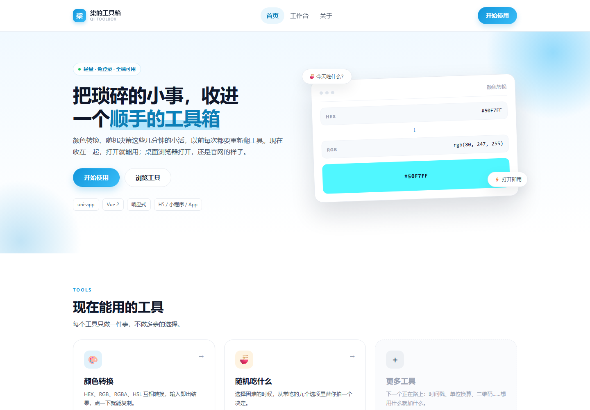
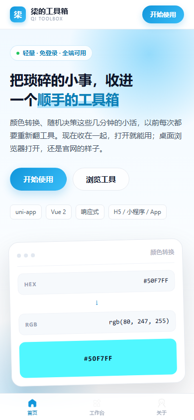
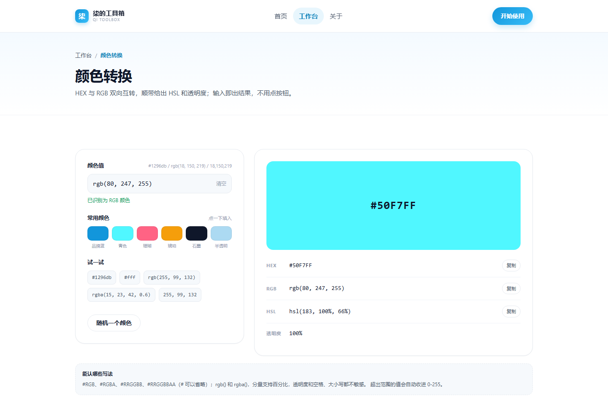

# 柒的工具箱 · ssrmock-toolbox

一个轻量的前端小工具箱，用 **uni-app（Vue 2）** 写成，一套代码同时跑 H5、微信小程序和 App。
桌面浏览器打开时自动切换成官网式布局（顶部导航 + 落地页 + 页脚），手机上则是熟悉的 App 手势（底部导航）。

## 能做什么

### 1. 颜色转换
- **双向**：`#1296db` ↔ `rgb(18, 150, 219)`，任意一种输入都会同时给出另一种写法
- 支持 `#RGB`、`#RGBA`、`#RRGGBB`、`#RRGGBBAA`（`#` 可省略）
- 支持 `rgb()` / `rgba()`，分量可写百分比，透明度支持 `0.5` 或 `50%`
- 额外给出 HSL、透明度，以及大色块预览
- 输入即转换（不需要点按钮），结果一键复制
- 数值越界会自动收进 0-255，非法输入会给出明确提示

### 2. 随机吃什么
- 从 9 个常吃选项里随机抽一个，带滚动动画
- 自动避开上一次的结果，记住上次选择和累计次数（本地存储）

## 页面结构

| 路径 | 说明 | 桌面端呈现 |
| --- | --- | --- |
| `pages/home/index` | 首页（官网式落地页） | Hero + 工具卡片 + 特性 + CTA + 页脚 |
| `pages/work-bench/index` | 工作台（工具入口） | 三列卡片 + 使用提示 |
| `pages/tools/color/index` | 颜色转换 | 左右分栏（输入 / 预览） |
| `pages/tools/food/index` | 随机吃什么 | 左右分栏（结果 / 选项） |
| `pages/mine/index` | 关于项目 | 双栏信息卡 |

## 界面预览

| 桌面端首页（官网式落地页） | 手机端首页 | 桌面端颜色转换 |
| --- | --- | --- |
|  |  |  |

> 截图是 `dev/` 运行器里真实跑起来的 H5 版本（桌面 1440px / 手机 390px）。

## PC 模式适配

断点约定：

| 宽度 | 布局 |
| --- | --- |
| `< 768px` | 手机：单列、底部导航、大号点击区域 |
| `768px - 1023px` | 平板：两列网格，顶部出现菜单 |
| `>= 1024px` | 桌面：1180px 居中容器、顶部导航 + 下拉页脚、双栏工具页、鼠标 hover 反馈 |

实现要点：

- 底部导航（`components/app-tabbar`）在 `>= 1024px` 时隐藏，改由顶部导航（`components/app-nav`）接管
- 内容容器 `.container` 在桌面端为 1180px 居中，手机端留 20px 边距
- 首页首屏在桌面端变成左右两栏（文案 + 演示卡片），并显示悬浮标签
- 所有页面 `navigationStyle: custom`，导航栏自己画，才能保证桌面和手机一致

## 目录结构

```
├── App.vue                 全局样式（设计变量、容器、按钮、卡片等原子类）
├── main.js                 入口（兼容 Vue2/Vue3 条件编译）
├── pages.json              页面路由：全部使用自定义导航栏
├── manifest.json           应用配置（H5 标题 / 小程序 appid / 精简的安卓权限）
├── uni.scss                设计变量（品牌色、中性色、圆角、阴影）
├── components/
│   ├── app-nav/            顶部导航（桌面完整菜单，手机精简）
│   ├── app-tabbar/         底部导航（仅手机/平板）
│   ├── app-footer/         页脚（桌面为主，手机自动堆叠）
│   └── tool-card/          工具卡片
├── pages/
│   ├── home/               官网式首页
│   ├── work-bench/         工作台
│   ├── tools/color/        颜色转换
│   ├── tools/food/         随机吃什么
│   └── mine/               关于
├── docs/preview/           界面截图（README 用）
├── dev/                    命令行运行器（uni-app CLI，不参与 HBuilderX 构建）
└── utils/
    ├── color.js            颜色解析 / 转换（纯函数，无平台依赖）
    ├── food.js             食物数据 + 抽取逻辑
    └── nav.js              路由表、跳转、返回、复制
```

## 运行

### 方式一：HBuilderX（日常开发）

1. HBuilderX → 「文件 / 导入 / 从本地目录导入」选择本目录
2. 运行 → 运行到浏览器（H5）：把浏览器窗口拉到 1024px 以上即可看到 PC 官网布局
3. 运行 → 运行到小程序模拟器（微信）：需要在 `manifest.json` 里换成自己的 appid

### 方式二：命令行跑在浏览器里（`dev/` 运行器）

`dev/` 目录里放了一套 uni-app 官方 CLI 的构建依赖，用 `UNI_INPUT_DIR=..` 直接编译根目录的源码，
**不需要把页面搬进 `src/`**，HBuilderX 工程结构保持不变。

```bash
cd dev
npm i          # 首次安装约 1-2 分钟，装完会自动打补丁
npm run dev:h5 # 打开 http://127.0.0.1:5273
```

- 改根目录的 `.vue` / `.scss` 会热更新，不用重启
- `npm run build:h5` 产出静态文件到 `dev/dist/build/h5`
- `dev/node_modules`、`dev/dist` 已在 `.gitignore` 里
- 安装后的 `postinstall` 会自动执行 `scripts/patch-compiler-utils.js`：uni-app 的模板编译依赖它自带的 `@vue/component-compiler-utils` 修订版，否则会报 `Export 'recyclableRender' is not defined`。如果安装时用了 `--ignore-scripts`，补跑一次 `npm run patch` 即可

## 加一个新工具

1. 在 `pages/tools/<name>/index.vue` 新建页面（可以直接抄颜色转换页的结构）
2. 在 `pages.json` 的 `pages` 里注册，`navigationStyle` 设为 `custom`
3. 在 `utils/nav.js` 的 `PAGE` 里加一条路径
4. 在工作台 / 首页的 `tools` 数组里加一张卡片

## 更新日志

- **v1.1.0**：首页改成官网式落地页并完成 PC 适配；颜色转换支持双向解析、透明度、HSL 与一键复制；随机食物真正实现随机；补齐工作台与关于页；清理调试代码与冗余配置
- **v1.0.0**：搭好 uni-app 骨架，实现 rgb 转十六进制的初版
